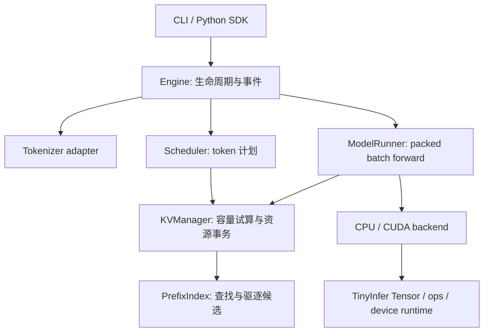

# 架构与模块所有权

状态：2026-10-22 的目标架构，当前仅 request.h 为代码数据契约；各执行模块尚待实现。
MiniPrefix 是 TinyInfer 的上层生成引擎，不创建第二套 Tensor、通用 allocator 或设备 runtime。

## 依赖与执行流



依赖只向下：算子不依赖请求调度，backend 不调用 Engine；Scheduler 不直接持有设备
指针或执行 kernel。Engine 执行调度计划，串联资源领取、forward、采样、事件提交和回收。

首版原生热路径采用 C++17。Python 负责用户适配、参考校验和实验编排；迁移期间可继续
通过原有 worker 协议驱动 C++。最终生成循环不以每轮 Python 文本 IPC 为必要条件。
绑定实现技术暂不锁定，等 C++ Engine 可用后再选择，避免骨架引入无用依赖。

## 模块边界

| 模块 | 拥有/负责 | 不负责 |
|---|---|---|
| Engine | 请求状态、已提交 token、输出事件、采样、完成/取消 | attention 数学、物理 block 分配细节 |
| Scheduler | 活跃/等待/暂停队列、token 预算、抢占选择、计划 | 权重、tokenizer、设备内存 |
| ModelRunner | 模型配置/权重引用、层执行、batch 元数据到 logits | 队列优先级、重复交付控制 |
| KVManager | 物理 pool、sequence table、引用、COW、增量资源事务 | 前缀搜索算法、文本处理 |
| PrefixIndex | 带模型上下文的前缀 key、索引、访问/驱逐策略 | 独立释放或写入共享物理块 |
| Backend | 算子/kernel、stream、completion 与设备更新 | HTTP、调度策略 |

PrefixIndex 通过 KVManager 管理的 lease 持有缓存引用；请求和快照都是明确的持有者。
驱逐先解除索引 lease，只有所有引用和在途设备访问都结束后，KVManager 才复用物理块。
ModelRunner 输出 logits/完成句柄，Engine 执行首版 Greedy 采样与 token 提交。

## 请求状态与恢复

```text
Waiting → Prefilling → Decoding → Finished
               ↘          ↙
                Suspended → Recomputing → Prefilling / Decoding
```

Waiting/活跃/暂停状态都可进入取消或失败的终态；终态只提交一次。
请求的已交付 token 是不可撤销记录，KV 重算只恢复计算状态，不触发重复事件。
重算使用已提交 token 作为 teacher-forced 输入，验证生成边界，不重新采样旧序列。

## GPU 与内存

- 模型权重加载后常驻 GPU；各层 KV 使用统一布局描述，不能硬编码 D=16/单头。
- CPU 持有请求、调度与索引 metadata，GPU 持有执行所需 KV/activation。
- 追加、COW、block table 更新走设备增量路径，热循环不复制完整 KV pool。
- 首版可以逐轮同步完成，先明确 completion 与资源所有权；异步重叠在测量后加入。
- CPU oracle 与 CUDA 使用相同模型语义，允许不同浮点执行顺序，用固定容差比较 logits。
- KV payload、KV pool 分配、工作区、权重、进程/设备总内存分别报告。

现有示例 CUDA pool 镜像路径可用于迁移对照，但不满足 GPU 常驻阶段验收。
优先使用 TinyInfer 的 CudaDeviceRuntime/DeviceBuffer/Completion；确有接口缺口时，
在 core 增加通用设备能力，避免把请求调度或模型专用逻辑塞进通用 runtime。
